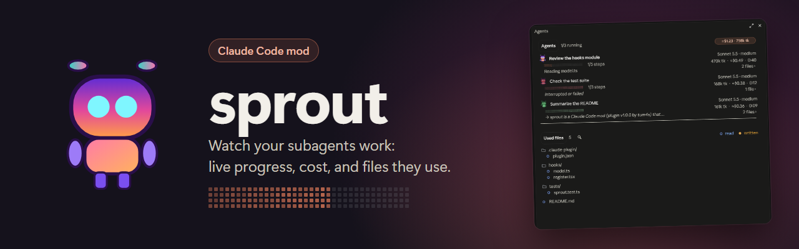

<p align="center">
  <picture>
    <source media="(prefers-color-scheme: light)" srcset="docs/brand/banner-light.png">
    
  </picture>
</p>

<p align="center">
  <a href="https://github.com/Tum4s/sprout/releases/latest"></a>
  <a href="LICENSE"></a>
  
  
  
</p>

<p align="center">
  <b>See what your subagents do, cost, and touch.</b>
</p>

<p align="center">
  <a href="#install">Install</a> ·
  <a href="#what-you-get">What you get</a> ·
  <a href="#language">Language</a> ·
  <a href="#progress-bar">Progress bar</a> ·
  <a href="#known-limits">Known limits</a>
</p>

---

## What you get

sprout stays out of sight until a subagent runs.

### The band


- Shows up above the prompt as soon as a subagent starts.
- Running agents, an animated progress bar, estimated cost, duration.
- Leaves one minute after the last agent ends.

### The Agents panel


Open it with **Agents ›** or `/sprout`. `/sprout clear` empties it.

- **One card per agent**: task, model, steps, context, tokens, cost, duration.
- **A mascot** per agent: walking while it runs, green when done, red on failure.
- **Used files**: every file the agents read (○) or wrote (●), as a tree.
- **Filter** on one agent with **N files ›**, or **search** with the magnifier and Enter.
- **Git marks** in a repository: M modified, A added, U untracked, D deleted.
- **Click** a file to attach it to your next message. **Double-click** to open it in Notepad.

## Install

```
/plugin install sprout --marketplace Tum4s/sprout
```

Answer `y` to add the marketplace, then pick the user scope. From a local copy of this folder instead:

```bash
claude plugin marketplace add "<path to this folder>"
```

```bash
claude plugin install sprout@tum4s --scope user
```

A plugin installed from a folder is read from that folder: after an edit, run `/reload-plugins` in the session, no reinstall. To try it without installing: `claude --plugin-dir "<path to this folder>"`.

## Language

French when your Claude speaks French, English otherwise. sprout reads Claude Code's `language` setting (`"language": "french"` in `settings.json`); without it, the system's language (`LANG`, or Windows' display language).

## Progress bar

When a subagent starts (forks aside), sprout appends a short note to its brief, unless the brief already names the tool: load the `mcp__sprout__step` tool, report the plan (`total`, `done: 0`), then each finished step. Nothing to ask; an agent without ToolSearch ignores the note. An agent that never calls it but keeps a todo list (TodoWrite, TaskCreate / TaskUpdate) gets its bar from the ticked tasks; otherwise the bar shows its context fill, in grey. When an agent answers, its bar completes.

## Known limits

- **Cost is an estimate**: Anthropic's official price table read on 2026-10-09 (`hooks/model.ts`), cache writes at the 1-hour rate (the real duration is not exposed). A model outside the table shows no cost.
- **Context as a %** only when the agent runs on the session's model (the only window the API exposes); otherwise a token count.
- Grep / Glob / Bash show as the "last action", not in the tree.
- The SVG drawings (dot bars, mascot) exist in the desktop app only; the terminal draws `▄` block bars.
- **Light theme**: the mods API does not tell the theme, so the SVGs switch colours themselves through `prefers-color-scheme` (solid dots, a 50 to 100 % fade, deeper orange and green).
- **Double-click** works on Windows only. It opens text files in Notepad (md, txt, json, csv, log, xml, yaml, toml, ini, sql, src, ts, tsx, py, css, html), never in their default app, which could run them. Network paths are refused.
- **Search** needs a text field, so it is not available on mobile.
- **Attached files** go to Claude as hidden context with your next message, then the selection empties.
- Only subagents with a loop id are followed (every local agent has one).

## Check after an edit

```bash
claude plugin validate .
```

```bash
claude plugin test .
```

Tested with Claude Code 2.1.287 (CLI) and the desktop app, October 2026. The mods API may change between versions: when it does, the types generated in `.claude-plugin/types/` are the reference.
