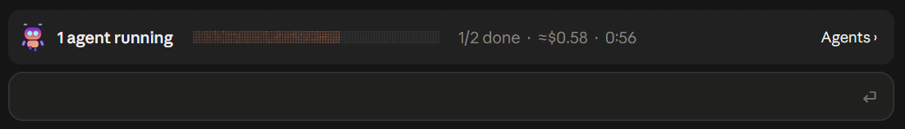
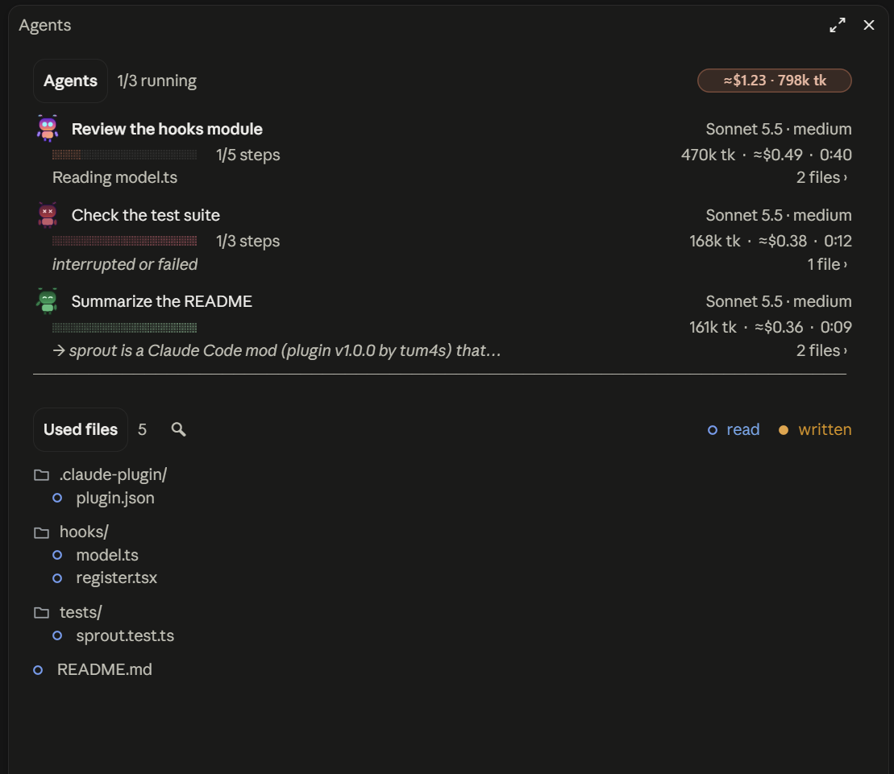

# sprout — subagent tracker

A Claude Code mod. It stays out of sight until a subagent runs.





- **Band above the prompt** as soon as a subagent starts: running agents, an animated dot-matrix bar, progress, estimated cost, duration. It leaves one minute after the last agent ends.
- **"Agents ›" button** (or `/sprout`; `/sprout clear` empties it first): a side panel with
  - one card per agent, with a mascot that walks while it works, turns green when done and red on failure: task, model · effort, bar, steps, context, tokens, cost, duration, the step in progress or last action, then the first line of the final answer;
  - the tree of the **files the agents read (○) or wrote (●)**; "N files ›" on a card (shown when it narrows the list) filters on that agent, "all" goes back to every file;
  - the **magnifier** next to "Used files" opens a search field; **Enter** filters on the path shown (relative to the session folder); the magnifier again closes the field and drops the filter (not on mobile, which has no text field);
  - **git**: inside a repository, a letter after the name follows `git status` (M modified, A added, U untracked, D deleted), read at start, after each agent write and when an agent ends;
  - **click** a file: it is marked "attached" and handed to Claude with your next message (as hidden context), then the selection empties; "clear" cancels it. **Double-click**: opens it in Notepad, text files only (md, txt, json, csv, log, xml, yaml, toml, ini, sql, src, ts, tsx, py, css, html). Notepad shows any file as text, where the default app could run it (a `.py` runs with Python).

## Install

```
/plugin install sprout --marketplace Tum4s/sprout
```

Answer `y` to add the marketplace, then pick the user scope. From a local copy of this folder instead:

```bash
claude plugin marketplace add "<path to this folder>"
```

```bash
claude plugin install sprout@tum4s --scope user
```

A plugin installed from a folder is read from that folder: after an edit, run `/reload-plugins` in the session, no reinstall. To try it without installing: `claude --plugin-dir "<path to this folder>"`.

## Language

French when your Claude speaks French, English otherwise. sprout reads Claude Code's `language` setting (`"language": "french"` in `settings.json`); without it, the system's language (`LANG`, or Windows' display language).

## Progress bar

When a subagent starts (forks aside), sprout appends a short note to its brief, unless the brief already names the tool: load the `mcp__sprout__step` tool, report the plan (`total`, `done: 0`), then each finished step. Nothing to ask; an agent without ToolSearch ignores the note. An agent that never calls it but keeps a todo list (TodoWrite, TaskCreate / TaskUpdate) gets its bar from the ticked tasks; otherwise the bar shows its context fill, in grey. When an agent answers, its bar completes.

## Known limits

- **Cost is an estimate**: Anthropic's official price table read on 2026-10-09 (`hooks/model.ts`), cache writes at the 1-hour rate (the real duration is not exposed). A model outside the table shows no cost.
- **Context as a %** only when the agent runs on the session's model (the only window the API exposes); otherwise a token count.
- Grep / Glob / Bash show as the "last action", not in the tree.
- The SVG drawings (dot bars, mascot) exist in the desktop app only; the terminal draws `▄` block bars.
- **Light theme**: the mods API does not tell the theme, so the SVGs switch colours themselves through `prefers-color-scheme` (solid dots, a 50 to 100 % fade, deeper orange and green).
- **Double-click** opens files on Windows only (Notepad); network paths are refused.
- Only subagents with a loop id are followed (every local agent has one).

## Check after an edit

```bash
claude plugin validate .
```

```bash
claude plugin test .
```

Tested with Claude Code 2.1.287 (CLI) and the desktop app, October 2026. The mods API may change between versions: when it does, the types generated in `.claude-plugin/types/` are the reference.
